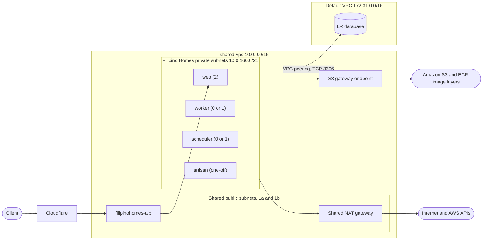

# Architecture

This document describes the parts of the system and how they connect.

## Summary

- One Docker image contains the API. The image operates in four roles: web, worker, scheduler and artisan.
- ECS on EC2 runs the containers on t3.medium instances in two private subnets.
- An Application Load Balancer in two public subnets sends HTTP requests to the web containers.
- Cloudflare is in front of the load balancer.
- The containers connect to the LR database through a VPC peering connection.
- One Secrets Manager secret contains all the production settings.
- On each push to `main`, GitHub Actions builds the image, pushes it to ECR and deploys it to ECS.

> [!NOTE]
> On 2026-11-17, Cloudflare still sends all traffic to the current EC2 server. Refer to [cutover.md](cutover.md).

## Diagram

## The four roles of the image

| Role | ECS resource | Command | Count on 2026-11-17 | Function |
|---|---|---|---|---|
| web | Service `filipinohomes-web` | FrankenPHP (the default command of the image) | 2 | Serves the HTTP API |
| worker | Service `filipinohomes-worker` | `php artisan queue:work --queue=default --memory=384` | 0 | Runs the queued jobs |
| scheduler | Service `filipinohomes-scheduler` | `filipinohomes-scheduler` | 0 | Runs the scheduled commands in `routes/console.php` |
| artisan | Task definition `filipinohomes-artisan` | `php artisan migrate:status` (default) | One-off | Runs migrations and other one-off commands |

## Path of a request

This is the path after the cutover:

1. A client sends a request to `api.filipinohomes.com`.
2. Cloudflare receives the request and sends it to the load balancer.
3. The load balancer sends the request to a web container. The container port is 8080. The host port is a dynamic port between 32768 and 65535.
4. FrankenPHP runs the Laravel application for the request.
5. The application connects to the LR database through the VPC peering connection.
6. The application connects to services on the internet through the shared NAT gateway. Traffic to Amazon S3 goes through the S3 gateway endpoint.

## Ownership

| Owner | Parts | Rule |
|---|---|---|
| Shared | `shared-vpc`, the internet gateway, the NAT gateway, the public subnets, the peering connection | Other systems also use these parts. Do not change them for Filipino Homes only. |
| Filipino Homes | The private subnets and their route table, the S3 endpoint, the load balancer, the cluster, the services, the ECR repository, the secret, the IAM roles | The templates in `infra/aws/` manage these parts. |
| LR | The LR database, its security group, the default VPC | This repository does not own these parts. The stack `filipinohomes-lr-db-access` adds one route and one security group rule only. |

## Design decisions

| Decision | Reason |
|---|---|
| One image for all roles | All roles run the same code from the same commit. |
| Bridge network mode, not `awsvpc` | In `awsvpc` mode, each task uses one network interface. A t3.medium has only 3. ENI trunking can increase this limit, but it is an account setting, and it is off. |
| All settings in one secret | Internal settings, and not only passwords, stay out of this public repository. |
| Laravel caches at container start | `php artisan optimize` runs when a container starts. The config cache contains the settings of the task, so the image cannot contain it. |
| Cache store `database` | A file cache is not shared between containers. When one container clears its cache, the other containers keep old data. |
| Health check `/up` without the database | If the database has a problem, the load balancer does not remove all containers from service. |
| The shared NAT gateway | The account is at its limit of Elastic IP addresses in this Region. For this reason, Filipino Homes uses the NAT gateway of `shared-vpc` and has no NAT gateway of its own. |
| No automatic migrations | The LR database contains production data for many applications. The image never runs migrations when it starts. The deploy workflow stops when a migration is pending. A person runs the migrations. |
| Only `main` can publish an image | Only the CI role can push to the ECR repository. Only workflow runs on `main` of the fork and of upstream can use that role. The services run the image of the last deployment from either repository. |
